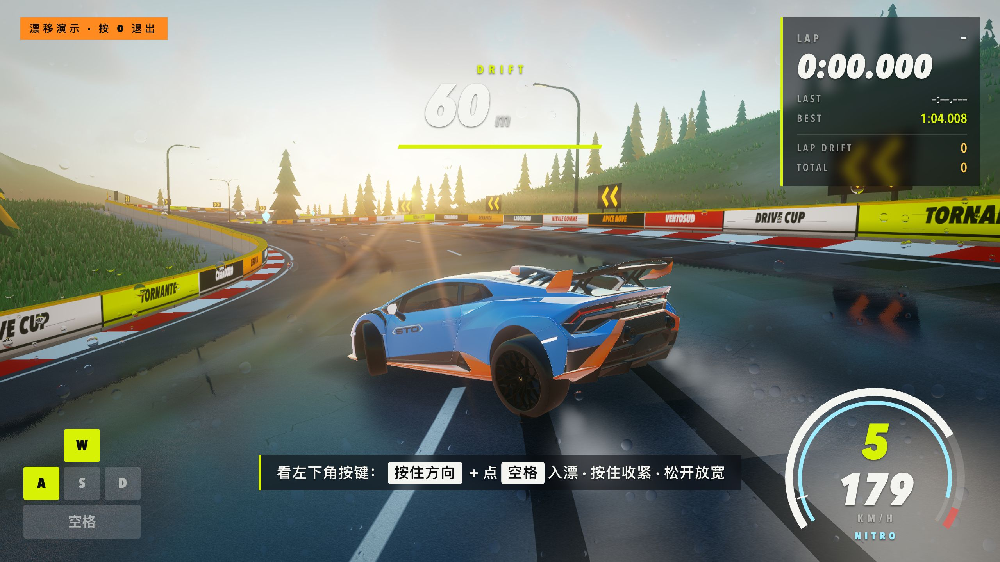

# DRIVE — 山谷赛道漂移计分

浏览器里的街机漂移赛车：一辆后驱超跑，一条 3.5 km 的山谷赛道，按「漂移距离 × 连击倍率」计分。PlayCanvas 引擎纯代码开发，TypeScript，WebGPU 优先、WebGL2 回退，桌面和手机都能玩。

*A browser arcade drift racer: one rear-drive supercar, a 3.5 km valley circuit, scored by drift distance × combo multiplier. PlayCanvas engine-only, TypeScript, WebGPU with WebGL2 fallback; keyboard, gamepad and touch.*



## 当前状态：v0.3.0（M3，2026-11-26）

三个里程碑的功能都已完成：

- **M1 能漂起来的一圈**：街机车辆物理、漂移状态机、计分与连击、圈速、弯道提示、教学提示、漂移演示。
- **M2 像样的画面**：程序化地形、湖、草和树、动态天空与体积云、湿路面平面反射、后处理、镜头水滴、氮气与拾取碎片。
- **M3 可发布**：程序化合成的音频（没有音频文件）、菜单/加载/暂停/致谢、手柄和触屏、四档画质、着色器预热，以及一轮性能与内存优化。

还没做或没确认的：引擎声没有经过真人试听；没在真手机和真手柄上试过；调试句柄和自动驾驶还在发布构建里。详见 [M3 验收记录](docs/verification/M3/README.md)。

## 运行

需要 Node.js 22.12 以上（Vitest 的要求）。

```bash
npm install
```

```bash
npm run dev
```

打开 http://localhost:5183 。开发服务器用的是引擎调试构建，帧率偏低；要看真实性能用生产构建：

```bash
npm run build && npx vite preview
```

`dist/` 是纯静态文件，可以放到任意静态托管的任意子路径下。

其他命令：`npm test`（单测与输入回放，Vitest）、`npm run typecheck`、`npm run track:report`（改赛道后打印各段数据并画俯视图）。

## 操作

| 动作 | 键盘 | 手柄 | 触屏 |
| --- | --- | --- | --- |
| 油门 / 刹车 | W S 或 ↑ ↓ | RT / LT | 自动油门 / 刹车按钮 |
| 转向 | A D 或 ← → | 左摇杆 | 左半屏按住后左右拖动 |
| 漂移 | 空格 | X | 漂移按钮 |
| 氮气（按住） | N 或 Alt | A | 氮气按钮 |
| 重置 | R | Y | 暂停菜单 |
| 暂停 | Esc | Start | 顶部暂停键 |

入漂手法：按提示车速入弯，按住方向朝弯心的同时点一下漂移键；按住方向收紧走线，松开放宽；出弯前松开。按 O 看漂移演示。

调试用的 URL 参数（`?play`、`?q=low|normal|high|ultra`、`?device=webgl2`、`?demo`、`?autopilot`、`?debug` 等）见 [CLAUDE.md](CLAUDE.md)。

## 项目结构

```
src/
  vehicle/ track/ gameplay/   纯逻辑（不依赖引擎，可在 Node 里无渲染运行和测试）
  world/ render/ vfx/ camera/ 画面
  audio/ input/ ui/           声音、三种输入、HUD 与菜单
  config/                     全部调参常量
tests/                        单测与手感回放
docs/design/                  玩法、赛道、渲染、车模的设计文档
docs/verification/            各里程碑的验收记录、截图与性能数据
scripts/                      车模构建、模型检查、赛道报告、验证脚本
```

开发约定、架构说明和验证要求都在 [CLAUDE.md](CLAUDE.md)（中文）。

## 致谢与许可

- 本项目的代码和文档：[MIT](LICENSE)。
- 车模：基于 "2023 Lamborghini Huracán STO"，作者 [adrianaflak09](https://sketchfab.com/adrianaflak09)，[CC BY 4.0](http://creativecommons.org/licenses/by/4.0/)，[原始页面](https://sketchfab.com/3d-models/2023-lamborghini-huracan-sto-19c4d3f7679e4765ac1f9c3be12c0899)。改动见 [huracan-sto.txt](public/assets/models/huracan-sto.txt)。该模型的来源无法完全核实，只建议用于非商业用途；商业使用前请换成来源清楚、带商用授权的模型。
- 引擎：[PlayCanvas Engine](https://github.com/playcanvas/engine)，MIT。
- 玩法和画面的方向参考了 PlayCanvas 风格的 Claude artifact 作品 OVERDRIVE；本仓库不包含它的源码或资源。

本项目是非商业性质的爱好者作品，与任何汽车制造商均无关联，也未获得其认可、赞助或授权。车型名称和标识归各自权利人所有。
