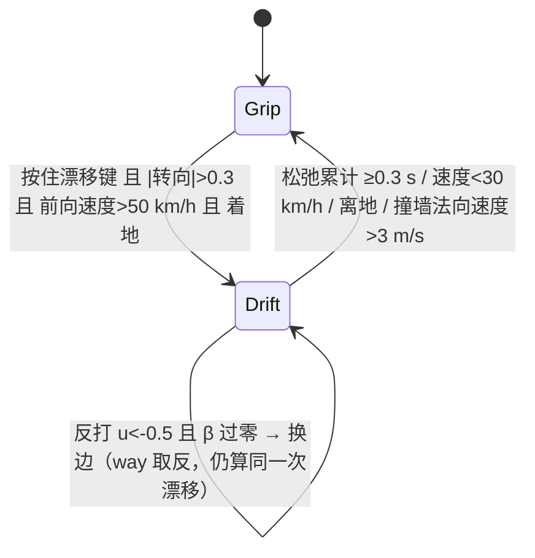

# 漂移玩法设计

> 结论：漂移物理和参考作品是同一套算法（已逐行对照其源码）：**抓地和漂移是两套独立的运动学模型**，固定 1/120 s 步长，没有轮胎力和质量。抓地模式用"速度 → 最大偏航角速度"查表；漂移模式对漂移角 β 做二阶弹簧控制，行驶方向单独转向。手感好不好主要取决于**赛道、车速和这套模型配不配**：打满方向时漂移走线的半径由车速决定，弯道半径要落在这条曲线上（见第 2 节）。计分 = 漂移距离（米）× 连击倍率（≤ ×5）。

原始数值与公式出处：`docs/research/vehicle.md`（下文用 §x 指它的章节）（该文档只在本地，不在公开仓库里）。

## 1. 模型总览

| 模式 | 每步做什么 | 手感来源 |
| --- | --- | --- |
| 抓地 Grip | 转向输入经斜率限制 → 目标偏航角速度 `steer × min(v/7, 查表(v))` → 一阶跟随（≈27 ms）→ 积分车头 → 横向速度按 `exp(−12·dt)` 衰减并**保持速度大小**（横向速度转成前向） | 转向立即、不掉速，纯街机 |
| 漂移 Drift | `bend`（往漂移方向打多少，带斜率限制）决定目标漂移角；β 用 ω=7、ζ=0.75 的弹簧追目标；行驶方向按 `min(0.8·bend·查表(v), v/18)` 转向；速度按 `4·|sin β|` 擦掉 | 角度和走线分开控制，好调、好预测 |

关键变量：`way`（漂移方向 ±1，入漂时锁定）、`bend`（往漂移方向打方向的滤波值，涨 2/s、落 4.5/s）、`β`（车头与行驶方向夹角）、`lull`（松弛累计时间）。完整伪代码见 §5、§5.5。

## 2. 漂移操作手法

### 2.1 标准手法（游戏里教的就是这四步）

| 步骤 | 按键 | 发生什么 |
| --- | --- | --- |
| 1. 减到入弯车速 | 松 `W`，必要时踩 `S` | 屏幕中上方的弯道提示显示下一个弯的方向和建议车速（如 `← 130`）。车速合适是绿色，偏快是橙色，必须马上刹车是红色并跳动 |
| 2. 入漂 | **按住**朝弯心的方向键，同时**点一下**空格 | 车速 > 50 km/h 时进入漂移，方向 = 当时按的方向。空格只是触发器，点一下就松；一直按着会以 5 m/s² 掉速 |
| 3. 控制走线 | **按住方向 = 收紧，松开 = 放宽**；`W` 一直踩着 | 按住时走线在 0.5 s 内收到最紧；松开后约 0.2 s 变回直线。有节奏地按、松就能贴着弯走 |
| 4. 出弯 | 车头快对准出口时松开方向 | 漂移角约 0.5 s 收回，再过 0.3 s 回到抓地。这段时间车走直线，所以要提前松 |

三条容易踩的坑：
- **入弯太快**：打满方向也收不住，会滑到外侧墙。漂移中可以踩 `S` 减速（刹车在漂移里照常有效）。
- **出弯松得太晚**：出漂要将近 1 秒，这期间不能转向，松晚了会冲到外侧。
- **漂移中一直不按方向**：角度会自己收回，约 0.8 s 后漂移结束。

### 2.2 为什么要看车速：走线半径由车速决定

打满方向时，漂移走线的半径只和车速有关（`max(18 m, v / (0.8 × 最大偏航角速度))`）：

| 车速 (km/h) | 72 | 90 | 108 | 126 | 144 | 162 | 180 | 198 | 216 | 250 |
| --- | --- | --- | --- | --- | --- | --- | --- | --- | --- | --- |
| 打满方向的走线半径 (m) | 18 | 18 | 22 | 31 | 40 | 46 | 55 | 66 | 74 | 90 |

所以每个弯有一个"按住方向正好切过去"的车速，这就是弯道提示上的数字（按弯道半径的 92% 反查上表）。比它慢，按住会切到内侧，要点按；比它快，打满也会滑出去，要先刹车。踩着油门漂移时车速基本不变（推力和漂移阻力大致平衡），所以入弯车速对了，整个弯都好控制。

### 2.3 进阶操作

| 操作 | 结果 |
| --- | --- |
| 油门 + 轻点方向 | 保持至少 22.5° 的漂移角（`hold` = 0.5） |
| 收油 | 目标角降到 40%（45° → 18°），弹簧变软 |
| 轻反打 | 走线变直、角度减小，β 过零后 0.3 s 出漂 |
| 重反打（反向按住）且 β 过零 | **换边**继续漂（钟摆），算同一次漂移，不加倍率 |
| 按住漂移方向不放 | 出漂计时被挡住，能一直漂 |
| 漂移结束后 1.5 s 内再入漂 | 连击，倍率 +1（爬坡 S 弯就是为这个设计的） |
| 撞墙法向速度 > 3 m/s | 出漂 + 连击清零 + 震屏 |
| 先点空格、0.25 s 内再按方向 | 也能入漂（空格有 0.25 s 的缓冲，不要求两个键同一瞬间按下） |

### 2.4 游戏里怎么教

- **弯道提示**（`#pace`）：前方 330 m 内有漂移弯时显示方向和建议车速；半径大到不用减速的弯显示"全油门"。
- **教学提示**（`#coach`，屏幕下方一行）：前 3 次入弯提示"按住 A/D 朝弯心，同时点一下空格"；前 4 次漂移中提示"按住收紧、松开放宽"；入弯太快提示先刹车；连击窗口内提示再次入漂。做过几次后不再出现。
- **漂移演示**（按 `O`，或 `?demo`）：一个只会按键盘的机器人按上面的手法开，左下角实时显示它按了哪些键。它的输出只有 −1/0/+1 的转向和开/关的踏板，决策间隔 0.09 s。
- **胎烟和胎痕**：车身侧滑角 > 0.12 rad 且车速 > 10 m/s 时后轮冒烟；胎痕深浅跟着 `screech`（侧滑速度、横向加速度、刹车三者取大）。

### 2.5 手感返工记录（2026-11-25）

M1 第一版玩家反馈手感不好。逐行对照参考源码后确认物理算法一致。随后写了一个键盘式机器人（`src/debug/drift-bot.ts`）在几种配置上跑同样的策略，每种 3 圈：

| 配置 | 早期机器人（入弯偏快、打满时会松手、出弯松得晚） | 最终机器人（按第 2.1 节的手法） |
| --- | --- | --- |
| 参考赛道 + 参考车 | 撞 15 次 | 撞 6 次 |
| 第一版赛道（路宽 16 m、12 个弯）+ 第一版车 | 撞 45 次 | **0 次**，连击到 ×4，14088 分 |
| 现在的赛道（路宽 18 m、9 个弯）+ 现在的车 | — | **0 次**，连击到 ×2，5776 分 |

结论和最初的判断不一样：**第一版赛道并不是开不过去**，手法对了它同样一次不撞。真正决定成败的是三件事——入弯车速、需要收紧时一直按住不松、出弯提前松手——而第一版游戏对这三件事没有任何提示，仪表上的速度在漂移时还偏低 30%。所以这次返工的重点是把手法教清楚、把反馈补上，其次才是让赛道更宽容。

改了什么：
- **教学与反馈（主要）**：弯道提示（方向 + 建议入弯车速）、教学提示、漂移演示（按 `O`）、胎烟、胎痕；仪表速度改显示实际行驶速度。
- **容错**：空格 0.25 s 入漂缓冲；撞墙判定里车身朝向的伸出量只算一半（`wallAngleReach` 0.5）；沥青加宽到 18 m（和参考一致）。
- **车**：推力 11.2 → 14 m/s²、刹车 28 → 34 m/s²、最小转弯半径 7.5 → 7 m，改回参考值。
- **赛道**：弯道半径从 27–65 m 改成 35–75 m，除一组 S 弯外每个弯后面接至少 130 m 直线（出漂那 1 秒要走直线），12 个弯减到 9 个。代价是连击机会变少（机器人从 ×4 降到 ×2）。第一版布局的段落表记在 `track-and-world.md` 第 2.4 节，想要更多弯和连击可以换回去。

没做的：音效（M3）。真人手感仍需玩家确认，机器人只能证明"按这个手法用键盘开得过去"。

## 3. 计分、氮气、圈速规则

### 3.1 漂移计分（基线 = 参考作品）

| 规则 | 值 |
| --- | --- |
| 累计量 | 漂移中每帧 `chain += |前向速度| × dt`（米）。45° 时只记路径长度的 71% |
| 连击窗口 | 上一次漂移结束后 **1.5 s** 内再次入漂 → 倍率 +1 |
| 倍率上限 | ×5，作用于**整串连击**，在连击结束时一次结算 |
| 入账 | 连击窗口超时 → `round(chain × mult)` 加入总分；`chain < 5 m` 不入账 |
| 清零 | 连击存续期间（含 1.5 s 窗口）撞墙法向速度 > 3 m/s → "WIPED OUT"，全部作废 |
| HUD | 漂移中显示米数、×N、1.5 s 倒计时条；入账显示 `+分数` 金色；清零显示红色删除线 |

### 3.2 我们与参考作品的差异（都放进 `src/config/scoring.ts` 可开关）

| 编号 | 差异 | 默认 | 理由 |
| --- | --- | --- | --- |
| S1 | 圈面板同时显示**本圈漂移**和**本局总分** | 开 | 参考作品标着 "DRIFT" 但其实是整局总数，容易误解 |
| S2 | 角度系数：`chain += |v_path| × dt × f(β)`，`f` 在 15°→45° 从 0.6 升到 1.2 | 关，M1 试玩后决定 | 参考作品没有角度奖励，大角度反而得分少；漂移游戏通常奖励角度 |
| S3 | 换边（钟摆）时给一次小奖励（如 +0.5 倍率步进） | 关 | 鼓励连续 S 弯技巧 |
| S4 | 本地存最佳圈速和最高单串得分（`localStorage`） | 开 | 参考作品刷新即丢 |

### 3.3 氮气（基线 = 参考作品）

| 规则 | 值 |
| --- | --- |
| 开局 | 0.6 罐 |
| 启动条件 | 按住、着地、罐 > 8%；启动后一直喷到松手或喷空 |
| 消耗 | 0.25 罐/s（满罐 4 s） |
| 推力 | 替代油门：`46·(1+1.2·surge)·(1 − v/cap)`，cap = 106 + 14·surge m/s |
| 满罐冲刺 surge | 罐 > 99% 时开喷，surge=1，3 s 线性衰减；峰值约 386 km/h（不满罐约 365 km/h） |
| 回充 | 平时 0.015/s；漂移中 +0.2/s（共 0.215/s，约 4.65 s 漂满）；空中 0.25/s |
| 拾取碎片 | 每个 +0.2 罐；每圈 11 个；吃掉后 8 s 重生；判定框沿赛道 −2…+2.8 m、横向 ±2.4 m。摆放规则：6 个漂移弯各在出弯后 10 m、偏外侧 4 m 放一个；3 个高速长弯各在弯中偏外侧 4 m 放一个；两段最长的直道各在中点、偏向下一个弯内侧 4 m 放一个（`src/gameplay/pickups.ts`） |
| 喷完 | 超过常规极速的部分按 7 m/s² 回落 |
| 表现 | 满罐提示音 + 屏幕边缘闪光；喷射时 FOV +14°、相机后拉 0.9 m、色散/Bloom/暗角/速度线加强；4 道蓝白尾焰，surge 时焰尖转橙 |

### 3.4 圈速

- 起终点在赛道弧长 28 m 处，出生点在其后 24 m（滚动起步，第一次过线只开始计时）。
- 圈内弧长落在 45%–55% 区间时置"半圈"标记；向前过线且有标记才算完成一圈；倒着过线清标记。
- 无限圈，记录 LAST / BEST。

## 4. 参数表：参考值 → 当前值

"当前值"列是 M1 手感返工后的取值，所有值放 `src/config/car.ts`、`src/config/drift.ts`。

| 参数 | 参考值 | 当前值 | 依据 |
| --- | --- | --- | --- |
| 物理步长 | 1/120 s | 1/120 s，**每帧最多 8 步** | 参考作品不限步数，卡顿后会追帧过多 |
| 推力（0 速时） | 14 m/s² | **14 m/s²** | 用参考值：漂移阻力按这个推力平衡。0–100 km/h 2.4 s、0–200 km/h 6.4 s，比 STO 官方（3.0 s / 9.0 s）快。第一版用过 11.2（贴官方数据），漂移中掉速偏快 |
| 常规极速 | 80 m/s（288 km/h） | **86 m/s（310 km/h）** | STO 官方极速 |
| 刹车 | 34 m/s² | 34 m/s² | 用参考值；入弯前要能快速减到提示车速，漂移中也靠它减速 |
| 倒车 | 14 m/s²，最高 14 m/s | 同 | — |
| 滑行阻力 | 0.6 + 0.0005·v² | 同 | — |
| 转弯掉速 | 0.03·|yawRate·v| | 同 | — |
| 路肩额外阻力 | 2.2 m/s² | 同 | — |
| 转向斜率 | 打入 16/s，回正/反向 18/s | 同 | — |
| 偏航响应 | 32/s | 同 | — |
| 最小转弯半径 | 7 m | 7 m | 用参考值 |
| 偏航查表 [km/h, °/s] | [0,130],[70,120],[145,72],[215,58],[290,52],[400,47] | 同起步 | 先不动，试玩后调 |
| 入漂最低速度 `handbrake` | 50 km/h | 同 | — |
| 入漂缓冲 `entryBuffer` | 无（空格和方向必须同时按着） | 0.25 s | 点一下空格后 0.25 s 内按方向也算，降低按键时机要求 |
| 漂移键掉速 `bleed` | 5 m/s² | 同 | — |
| 最大漂移角 `angle` | 45° | 45°（可试 50°） | 中置后驱，可以更"甩"一点 |
| `hold` / `lift` | 0.5 / 0.4 | 同 | — |
| 弹簧 `snap` / `damping` / `grip` | 7 rad/s / 0.75 / 3 rad/s | 同 | — |
| 走线 `path` / `radius` | 0.8 / 18 m | 同 | — |
| `ease` / `unwind` | 2/s / 4.5/s | 同 | — |
| 漂移擦速 `drag` | 4 m/s² × |sin β| | 同 | — |
| 出漂 `exit` / `settle` | 6° / 0.3 s | 同 | — |
| 墙：横向极限 | 8.85 m（路半宽 9 + 路肩 1 − 半车宽 1.05 − 0.1），只看车中心 | `路半宽 9 + 路肩 1 − 伸出量 − 0.1`。伸出量 = 半车宽 0.97 + `wallAngleReach` 0.5 ×（按朝向算的车身伸出 − 0.97），正着贴墙是 8.93 m，45° 斜着是 8.40 m | 参考作品只看车中心，车斜着撞墙时车头会穿进墙里；全按朝向算又会让漂移可用路宽少 2 m。取一半 |
| 墙：反弹 / 掉速 | 0.25 / 每 m/s 法向速度 2.2%（≤55%）+ 滑擦 35%/s | 同 | — |
| 重力 / 下压力 | 19 m/s² / 0.025·v² | 同（不做跳跃） | 参考作品的离地代码在平滑赛道上实际不触发 |
| 变速箱（仅表现） | 6 挡，升挡点 18/31/44/58/76/108 m/s，降挡 75% | **7 挡**（Huracán 7 速双离合），升挡点约 16/27/38/50/63/76/100 m/s | 挡位只影响声音、转速表和换挡回火 |
| 转速表 | 7600 rpm 满刻度，7000 红线 | 9000 满刻度，**8500 红线**（约值，待核实） | V10 高转特性 |
| 氮气 cap | 106 m/s | 100 m/s（360 km/h），surge +14 | 与常规极速的比值略收 |

## 5. 输入映射

| 动作 | 键盘 | 手柄（标准映射） | 触屏 |
| --- | --- | --- | --- |
| 油门 | W / ↑ | RT（模拟量） | 自动油门（首次触摸后） |
| 刹车/倒车 | S / ↓ | LT（模拟量） | Brake 按钮 |
| 转向 | A D / ← → | 左摇杆 X，死区 0.12 | 左半屏按住后左右拖动（虚拟方向盘 ±90°，落指处为回中位置） |
| 漂移 | Space | X | 「漂移」按钮（最大，右下角） |
| 氮气 | Alt / N（按住） | A | 「氮气」按钮（按住） |
| 暂停 | Esc | Start | 顶部暂停键；失焦、转竖屏自动暂停 |
| 重开 | R | Y 或 Select | 暂停菜单 |
| 暂停菜单 | ↑ ↓ 选择，Enter 确认 | 十字键或左摇杆上下选择，A 确认 | 直接点 |
| 漂移演示 | O | — | — |
| 静音 | M | 暂停菜单 | 暂停菜单 |

教学提示按最后用过的设备换词（`src/ui/coach-text.ts`）。手柄撞墙有震动。

与参考作品的差异：触屏方向盘灵敏度改为**随速度降低**（参考作品是随速度升高，高速容易过度转向）；`O` 键是漂移演示（键盘式机器人，左下角显示它按的键），`P` 键是纯追踪中心线、不会漂移的自动驾驶（开发工具，发布构建去掉）。

## 6. 手感验收场景（M1 必须逐条验证）

| # | 场景 | 期望 |
| --- | --- | --- |
| F1 | 静止全油门 | 0–100 km/h 约 2.4 s，0–200 约 6.4 s |
| F2 | 100 km/h，打满方向 + 漂移键 + 油门 | 入漂，0.8 s 内角度到 40–45°，车沿 ≥18 m 半径走弧线 |
| F3 | F2 后回正方向 | 0.6 s 内漂移角收到 6° 以内，约 0.8 s 退出漂移状态（收角后还要等 0.3 s 松弛时间），无甩尾 |
| F4 | F2 后重反打 | 换边继续漂，HUD 漂移计数不中断、倍率不变 |
| F5 | 漂移结束 1.5 s 内再次入漂 | 倍率 +1，播连击音（音高随倍率升高） |
| F6 | 超过 1.5 s 不再入漂 | 入账，显示 `+分数`，总分增加 |
| F7 | 连击中以 > 3 m/s 法向速度撞墙 | WIPED OUT，连击清零，震屏 |
| F8 | 贴墙轻擦（< 3 m/s） | 只掉速、火花、摩擦音，不清零 |
| F9 | 满罐开氮气 | 峰值速度高于非满罐开喷；4 s 喷空 |
| F10 | 漂移 5 s | 氮气约回满（0.215/s） |
| F11 | 倒着过线再正向过线 | 不计圈 |
| F12 | 低帧率（人为限制 20 fps） | 物理结果与 60 fps 一致，单帧最多 8 步 |

落实情况：F1–F10 都写成了输入回放（`tests/replays/*.json`，在开阔的测试场地或标准宽度椭圆赛道上跑，不依赖正式赛道布局），F5–F8、F11、F12 另有单测，氮气规则另有 `tests/nitro.test.ts`。M1 的实测值见 `docs/verification/M1/README.md`，氮气（F9、F10）的实测值见 `docs/verification/M2/README.md`。

## 7. 音频映射（与手感强相关的部分）

- 引擎：idle + low/mid/high 三层，按转速在对数域做等功率交叉淡化；音高 `max(0.6, rpm/ref)`，喷氮气 ×1.04；收油时引擎总线低通从 9 kHz 降到 1.8 kHz（"闷"）。
- **M3 的实际做法：全部程序化合成，没有任何音频文件**（`src/audio/`）。引擎是四个波表振荡器按转速交叉淡化，循环音是同一段噪声的不同滤波，一次性音效在建图时渲染进缓冲。这样不涉及素材版权；代价是引擎声不是真实 V10 的录音，听感没有人确认过。以后要换成录制或授权的 V10 素材时，只换引擎那四层的来源。
- 一次性音效：换挡（带 60 ms 引擎闪避）、收油回火（rpm > 0.55、速度 > 15 m/s）、撞墙（音量 ∝ 法向速度）、连击（音高随倍率）、入账、清零、过圈（破纪录音高 ×1.26）、拾取、满罐。
- 循环音：胎噪（按 `screech`）、擦墙、路噪、风噪（∝ 速度²）、路肩震动、环境音（隧道里静音）。
- 隧道：卷积混响（1.8 s 程序化噪声冲激）+ 0.16 s 回声，增强引擎基频。
- `screech = max((横滑速度 − 9)/6, (横向加速度/40 − 1.6)·2, 刹车量·clamp((v−8)/15))`，同时驱动胎噪、胎痕透明度。
